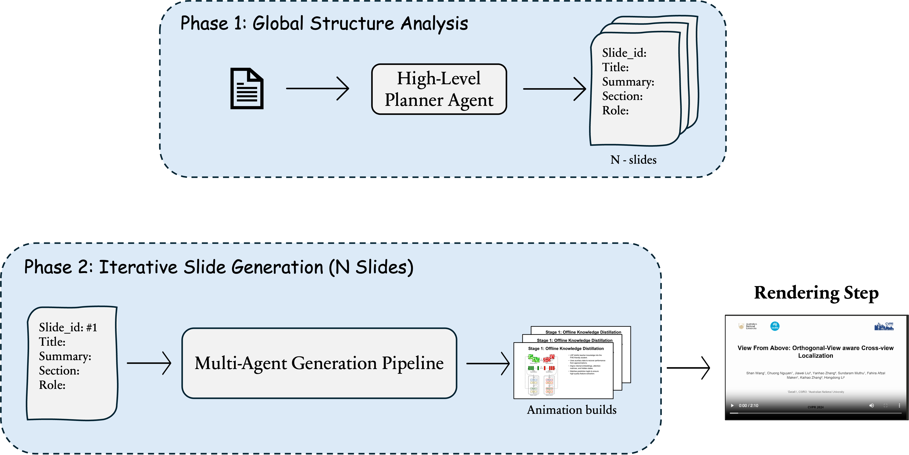
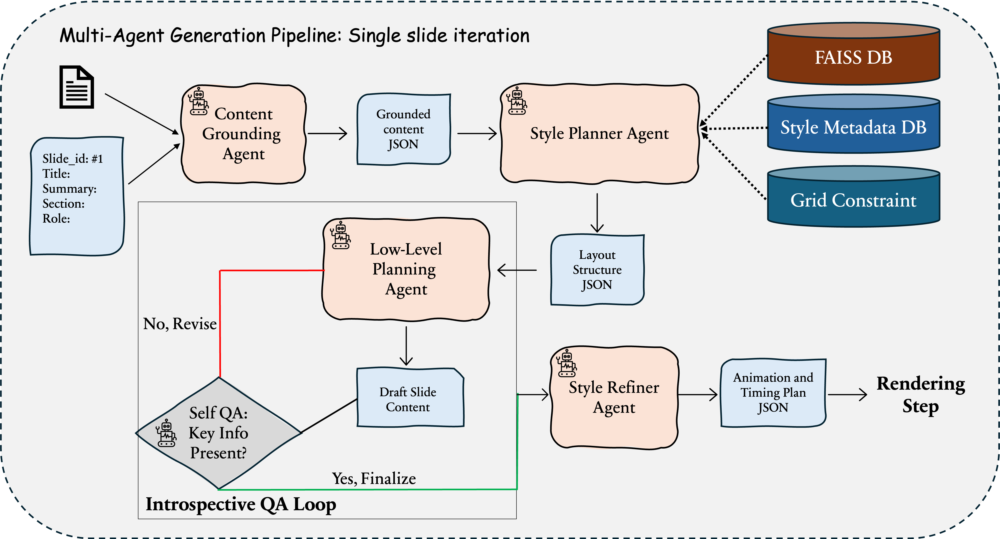

# Self Reflective Agent for Scientific Communication

## Architecture

### Overview



### Generation Pipeline



## Sample output

[Watch the demo video](assets/final_video.mp4)

## Quick Start

### Installation

```bash
conda create -n ref-agent python=3.10
conda activate ref-agent
pip install -r requirements.txt
```

### Setup

```bash
python run.py "dataset/attention.pdf" --output_dir "output/"
```

### Important

You should be having Gemini key and free alibaba key to run the script. If you are based in china you the china server, or else stick with Singapore server for international version.

## Acknowledgement

This is a follow-up work of Preacher (ICCV 2025)
